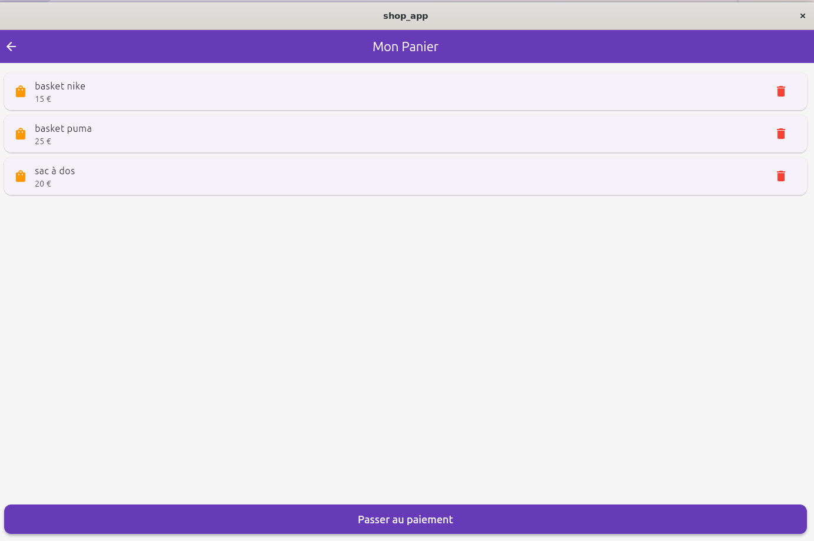
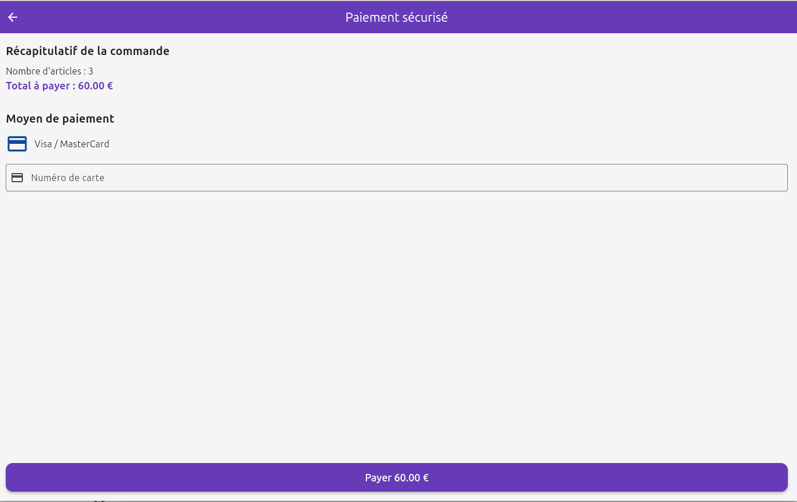
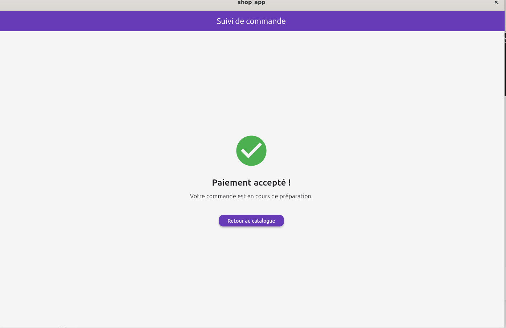

# 🛒 Application E-Commerce Flutter

Ce projet est une application mobile e-commerce développée avec Flutter, connectée à un backend headless Strapi v5 en local. 
Il respecte l'ensemble du tunnel d'achat (Catalogue -> Panier -> Paiement -> Commande).

## 🚀 Fonctionnalités implémentées
- **Boutique Strapi** : 10 produits, 3 catégories, 1 produit variable et 1 promotion.
- **Application** : Liste des produits avec image, nom et prix corrects.
- **Détail** : Écran détail, gestion du chargement et des erreurs.
- **Panier** : Panier d'achat fonctionnel (niveau 1 et plus).
- **Architecture propre** : Modèle, service et écrans séparés, aucune clé secrète dans le dépôt.

---

## 💻 Commandes de lancement

Pour tester ce projet en local, deux serveurs doivent tourner simultanément : le backend (Strapi) et le frontend (Flutter).

### 1. Lancement du Backend (Strapi)
Ouvrez un terminal, placez-vous dans le dossier de votre projet Strapi et exécutez :

    npm run develop

*(Le serveur doit être accessible sur http://localhost:1337)*.

### 2. Lancement de l'Application Mobile (Flutter)
Ouvrez un second terminal, placez-vous à la racine du projet Flutter et exécutez ces deux commandes :

    flutter pub get
    flutter run

---

## 📸 Captures d'écran du Tunnel d'Achat

### 1. Catalogue des produits

### 2. Fiche Détail d'un produit

### 3. Panier d'achat

### 4. Écran de Paiement

### 5. Confirmation de Commande
