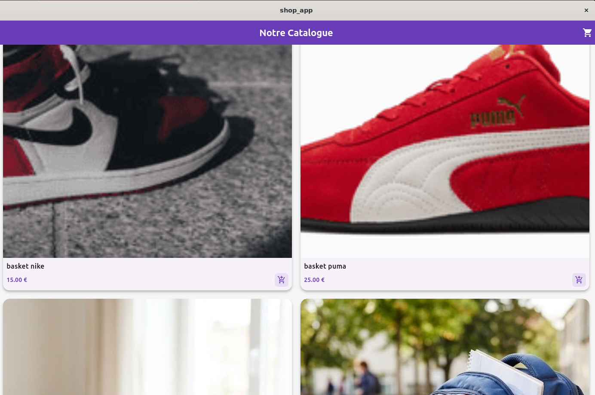
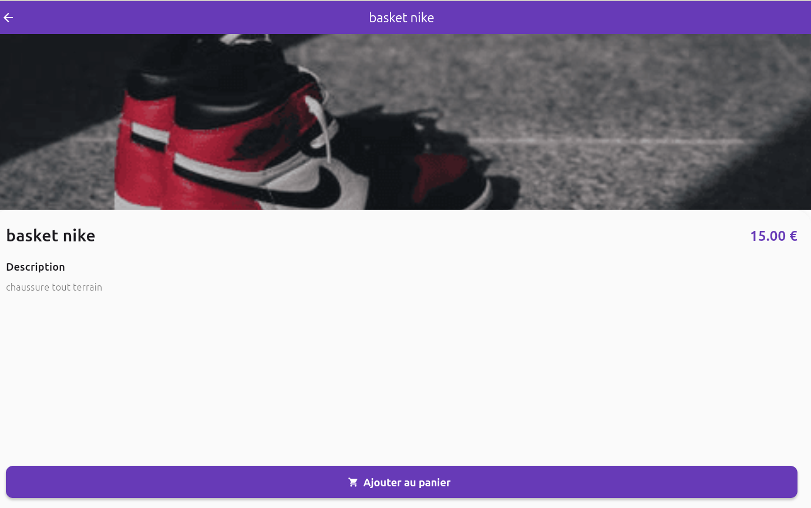

---


# 🛒 Application E-Commerce Flutter

Ce projet est une application e-commerce développée avec **Flutter**, connectée à un backend headless **Strapi v5**, hébergé sur **Render** avec une base de données **PostgreSQL**.

L'application suit le tunnel d'achat :

**Catalogue → Détail produit → Panier → Paiement → Confirmation de commande**

## 🚀 Fonctionnalités implémentées

- **Gestion des produits** : ajout, modification et suppression des produits depuis Strapi.
- **Catalogue** : affichage des produits avec leurs images, noms et prix.
- **Détail produit** : consultation des informations d'un produit.
- **Panier** : ajout de produits et gestion du panier d'achat.
- **Paiement** : interface de paiement.
- **Confirmation de commande** : affichage de la confirmation.
- **Architecture Flutter** : séparation des modèles, services et écrans.

## 🛠️ Technologies utilisées

- **Flutter / Dart** : développement de l'application.
- **Strapi v5** : backend headless et gestion des contenus.
- **PostgreSQL** : base de données.
- **Render** : hébergement du backend et de PostgreSQL.
- **GitHub** : gestion et partage du code source.

## 🌐 Backend Strapi sur Render

Le backend Strapi est hébergé sur Render. Il n'est donc plus nécessaire de démarrer Strapi localement pour utiliser l'application avec la base de données distante.

### Adresse du serveur

https://strapi-backend-13ae.onrender.com

### Adresse de l'API

https://strapi-backend-13ae.onrender.com/api

### Interface d'administration Strapi

https://strapi-backend-13ae.onrender.com/admin

### Accéder à l'administration

1. Ouvrir l'adresse d'administration Strapi.
2. Se connecter avec son compte administrateur.
3. Accéder à **Content Manager**.
4. Sélectionner **Produit**, **Category** ou **Panier**.
5. Consulter, ajouter ou modifier les données.

Les modifications sont enregistrées dans la base PostgreSQL hébergée sur Render.

## 💻 Installation et lancement de l'application Flutter

### 1. Prérequis

- Flutter SDK installé.
- Dart SDK.
- Git.
- Un environnement compatible avec Flutter.
- Une connexion Internet.

### 2. Cloner le projet

```bash
git clone https://github.com/hanael01/boutique-ecommerce-flutter.git
cd boutique-ecommerce-flutter/frontend
```

### 3. Installer les dépendances

```bash
flutter pub get
```

### 4. Lancer l'application

```bash
flutter run
```

Sélectionner l'appareil sur lequel exécuter l'application.

## ⚙️ Configuration de l'API

L'adresse du backend Strapi est configurée dans le fichier :

`lib/services/api_service.dart`

```dart
static const String baseUrl =
    'https://strapi-backend-13ae.onrender.com/api';
```

Les fichiers suivants utilisent également le serveur Render :

- `lib/screens/order_tracking_screen.dart`
- `lib/models/produit.dart`

L'application communique avec les API Strapi pour récupérer les produits et gérer les données.

## 🗃️ Base de données

La base de données PostgreSQL est hébergée sur Render.

Elle contient notamment :

- Les produits
- Les catégories
- Les paniers
- Les données gérées par Strapi

Les données initialement enregistrées dans une base SQLite locale ont été transférées vers PostgreSQL.

## 📸 Captures d'écran du tunnel d'achat

## 1. Catalogue des produits


### 2. Fiche Détail d'un produit


### 3. Panier d'achat


### 4. Écran de Paiement


### 5. Confirmation de Commande
